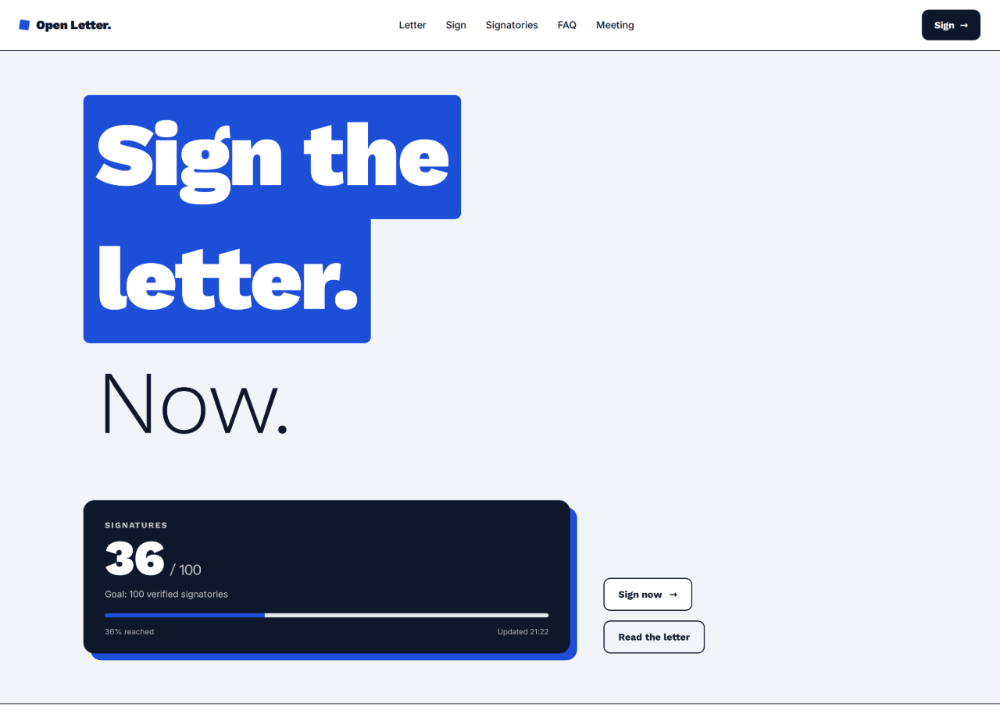
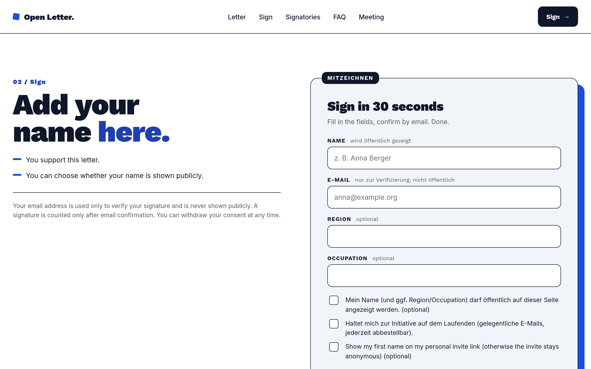
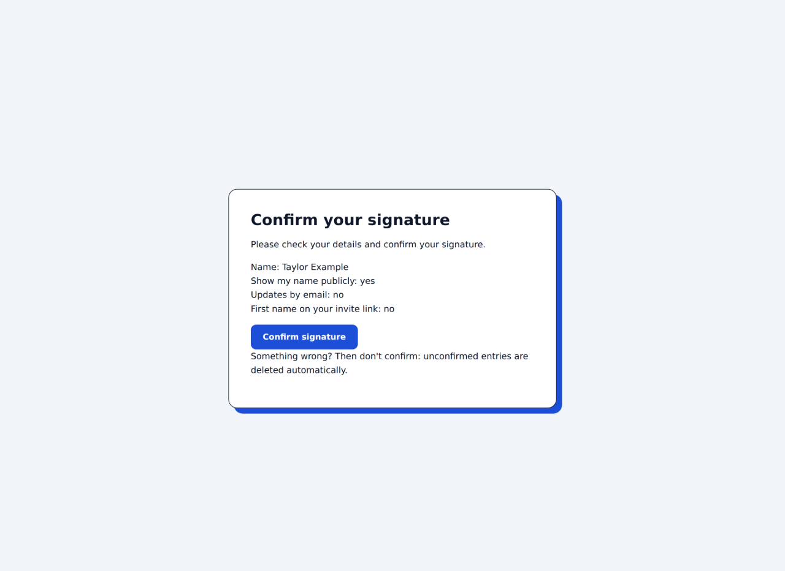
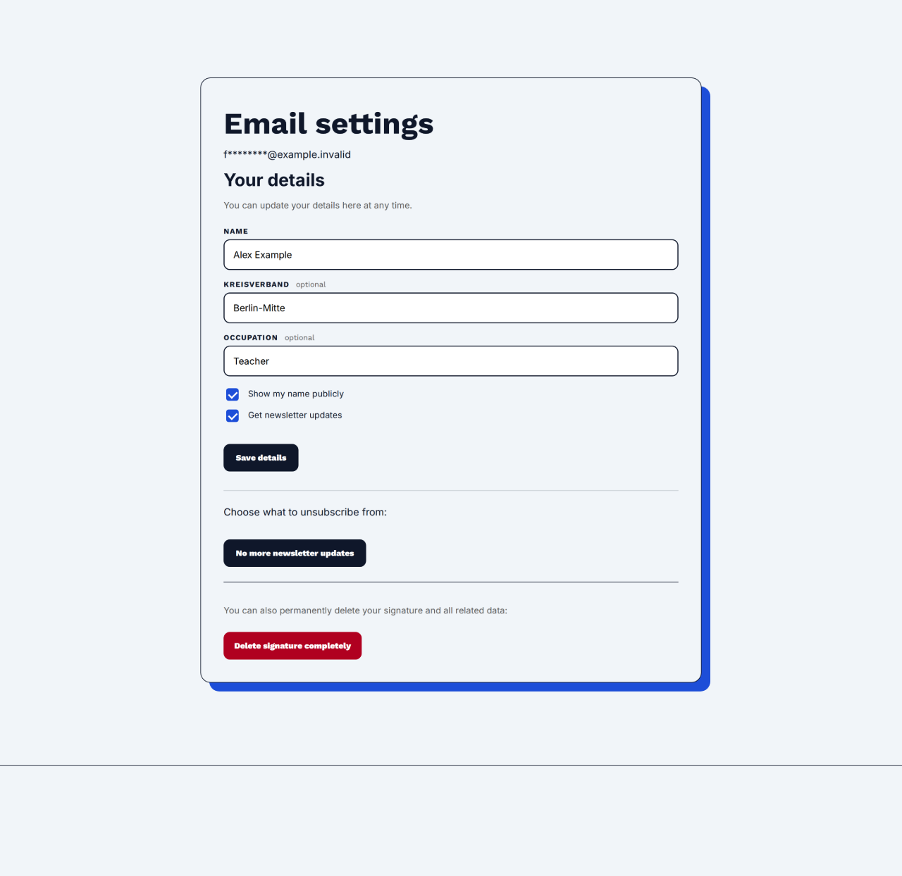
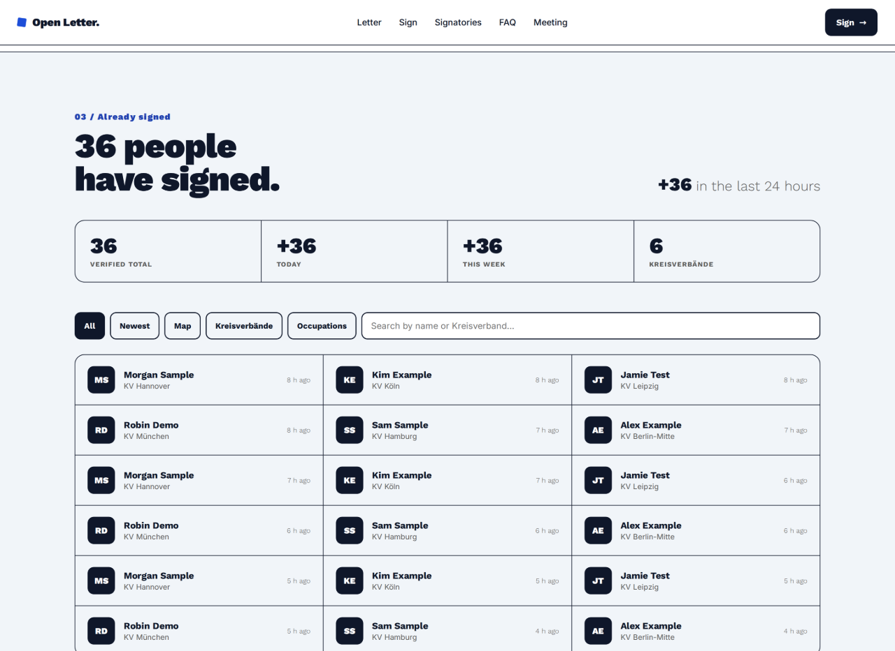
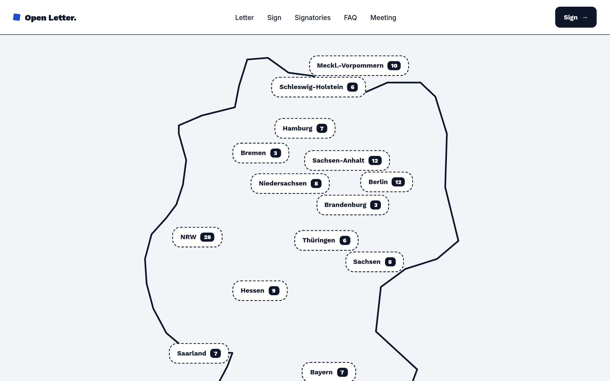
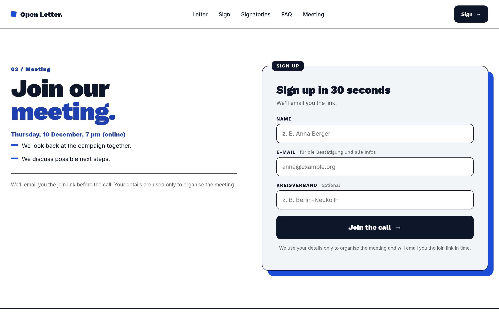
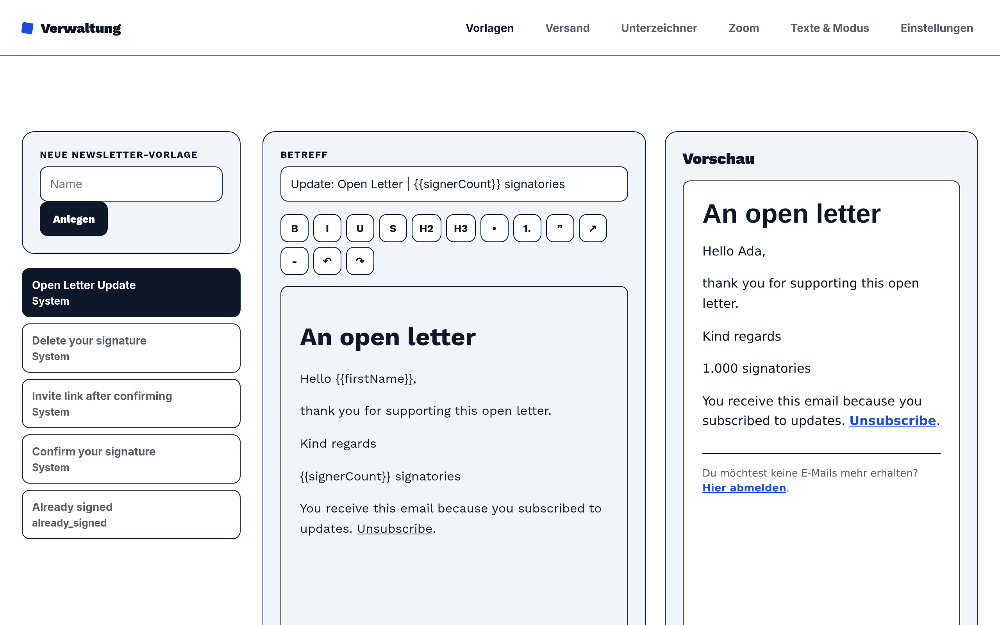
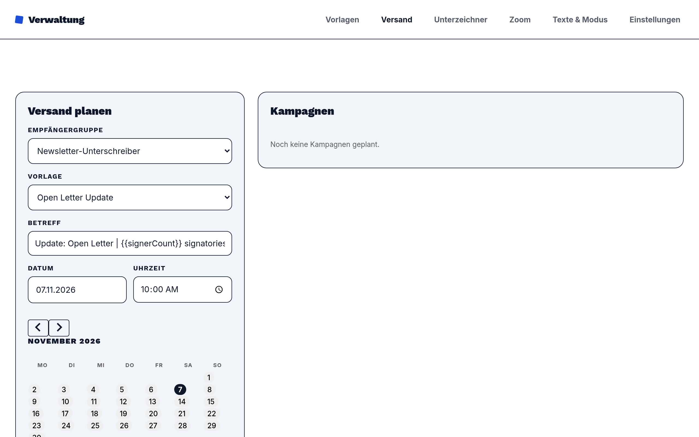
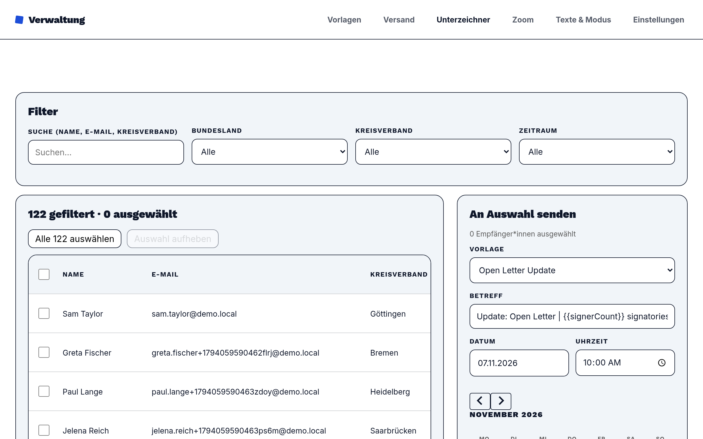

# Open letter

Run one open letter or petition on your own server. People sign and confirm by email. They choose whether to show their name publicly and whether to receive newsletters.

The admin interface publishes website content, layouts, branding, metadata, and email templates without a redeployment. SQLCipher stores the published versions and personal data in an encrypted SQLite database. Deployment configuration supplies the initial content and enables optional modules.



## What it does

- Collects email-verified signatures and shows a searchable public list and progress toward signature goals.
- Sends newsletters to a group or a selection of recipients, immediately or on a schedule.
- Sends email through Resend or SMTP and keeps queued work across restarts.
- Creates encrypted hourly backups and enforces the retention periods in the letter configuration.
- Supports multiple languages, with localized pages and email templates.
- Optionally adds a German-state map, regional affiliation and occupation fields, invitation links, and registration for an online or in-person meeting.

The map currently uses German states. Configurable city and country maps, moderation, guided setup, and saved audiences are proposals in the [single-letter roadmap](docs/single-letter-plan.md).

<table>
<tr><td width="33%"><a href="docs/screenshots/sign.png"></a><br><sub>Signature form</sub></td><td width="33%"><a href="docs/screenshots/confirm.png"></a><br><sub>Email confirmation</sub></td><td width="33%"><a href="docs/screenshots/self-service.png"></a><br><sub>Signer settings</sub></td></tr>
<tr><td width="33%"><a href="docs/screenshots/list.png"></a><br><sub>Public signer list</sub></td><td width="33%"><a href="docs/screenshots/map.png"></a><br><sub>Signatures by state</sub></td><td width="33%"><a href="docs/screenshots/event.png"></a><br><sub>Meeting registration</sub></td></tr>
<tr><td width="33%"><a href="docs/screenshots/admin-templates.png"></a><br><sub>Email template editor</sub></td><td width="33%"><a href="docs/screenshots/admin-campaigns.png"></a><br><sub>Scheduled newsletters</sub></td><td width="33%"><a href="docs/screenshots/admin-signers.png"></a><br><sub>Recipient selection</sub></td></tr>
</table>

These screenshots use the bundled `example` letter with all optional modules enabled. Open an image to see it at full size.

## Run the demo

```bash
cp .env.example .env
docker compose -f docker-compose.dev.yml up --build
```

Open http://localhost:3000. The demo creates 200 signers and adds another every six seconds. The placeholder credentials work for local setup. Real email delivery needs a configured provider.

To run locally without Docker, install [Bun 1.4.4](https://bun.sh), Git, and the Rust toolchain. The SQLCipher driver includes SQLCipher itself.

```bash
bun install
cp .env.example .env
bun run honker:build
bun run db:setup
bun run dev
```

Run `bun run db:seed` in another terminal to add demo signers.

## Set up your letter

1. Copy the starter with `cp -r config/letters/example config/letters/my-letter`.
2. Edit its `index.js` for branding, legal details, email defaults, and feature flags. Edit `content.jsx` for the letter and FAQ.
3. Register it in `LETTERS` in `config/letter.config.js` and `CONTENT` in `config/content.jsx`.
4. Set `LETTER_CONFIG=my-letter` before starting the app.
5. After startup, use the admin interface to edit and publish content, layout, images, and appearance.

See [configuration](docs/configuration.md) for the available settings. One deployment serves one letter.

## Deploy

Set the production environment values, then start the container.

```bash
docker compose up --build -d
```

| Variable                                           | Purpose                                                                                                                                 |
| -------------------------------------------------- | --------------------------------------------------------------------------------------------------------------------------------------- |
| `DATABASE_ENCRYPTION_KEY`, `BACKUP_ENCRYPTION_KEY` | Distinct SQLCipher keys for the database and backups. Generate each with `openssl rand -hex 32` and store them separately from backups. |
| `BASE_URL`                                         | Public URL used in pages and email links.                                                                                               |
| `ADMIN_PATH`, `ADMIN_PASSWORD`, `ADMIN_JWT_SECRET` | Admin route, password of at least 16 characters, and signing secret of at least 32 characters.                                          |
| `API_TOKEN_SECRET`                                 | Public API signing secret. Use a different value from `ADMIN_JWT_SECRET`.                                                               |
| `LETTER_CONFIG`                                    | Letter directory to load. Defaults to `example`.                                                                                        |
| `RESEND_API_KEY` or `SMTP_*`                       | Credentials for the chosen email provider.                                                                                              |

The database lives on a persistent volume. There is no separate database service. Compose sets `NODE_ENV=production`. Open `/<ADMIN_PATH>` to administer the letter and `/api/health` to check database and durable-job readiness.

If durable jobs are unavailable, health returns HTTP 503 and operations that require email reject changes before accepting them. Public pages and privacy controls remain available. Run one application process per database file.

Behind a reverse proxy, set `TRUST_PROXY=true` and enable gzip or Brotli at the proxy. See [operations](docs/operations.md) for backups, restoration, retention, and campaign closure.

## Hardware

Start with **1 vCPU, 1 GB RAM, and 20 GB SSD storage**. Give the app container a 512 MiB memory limit and leave room for Linux and the reverse proxy.

At one CPU and 512 MiB, the production image passed all five mixed-workload runs with 100,000 stored signers and 100 equivalent polling tabs. Four of five runs at 256 MiB ran out of memory during startup. These results describe the tested workload; they do not establish a traffic ceiling or a whole-server minimum. See the [hardware guide](docs/hardware.md) for the workload, measurements, and limits.

## Verify changes

Run these commands from the repository root after installing dependencies and building Honker:

```bash
bun run lint
bun test --timeout 60000
bun run verify:app
bun run verify:delivery
bun run verify:migration
```

The runtime checks use disposable encrypted databases and local email fixtures. Migration verification also starts a disposable PostgreSQL container and requires Docker. These checks do not send real mail or verify inbox delivery. See [load testing](loadtest/README.md) to repeat the hardware measurements.

## Stack

The app uses Bun 1.4.4, React 19, SQLite with [SQLCipher](https://www.zetetic.net/sqlcipher/), and [Honker](https://honker.dev) for durable jobs. The admin editors use Puck, Tiptap, CodeMirror 6, and Base UI. Resend or Nodemailer sends email. Optional built-in statistics use Analytik.

## Documentation

- [Configuration](docs/configuration.md)
- [Publishing and email administration](docs/publishing.md)
- [Delivery and storage ownership](docs/architecture.md)
- [Operations](docs/operations.md)
- [HTTP API](docs/api.md)
- [Security](docs/security.md)
- [Hardware requirements](docs/hardware.md)
- [Load tests](loadtest/README.md)
- [Proposed single-letter features](docs/single-letter-plan.md)

## License

[MIT](LICENSE)
